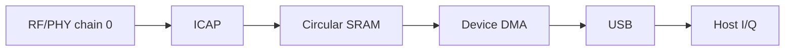

# BirriaSDR MT7961 RX fork

Turn a supported USB Wi-Fi dongle into an experimental SDR receiver with
**14-bit I/Q at 40 MSps complex**, with an experimental 80 MSps mode.

This is the [ot0tot/BirriaSDR](https://github.com/ot0tot/BirriaSDR)
receive fork, on branch `mt7961-wifi-usb`. It adds Windows support for the
generic MT7961 USB adapter (`0e8d:7961`), wider experimental tuning, an SDR#
source and a standalone spectrum receiver. The original project is
[BirriaSDR by luigifcruz](https://github.com/luigifcruz/BirriaSDR).
The [fork scope](docs/fork-scope.md) explains the differences.

Start with [Build and try](#build-and-try) for the driver, standalone app and
SDR# installation. You can use your existing compatible SDR# installation.
The standalone app needs no SDR# installation and provides spectrum,
waterfall, tuning, gain, snapshots and diagnostics. Audio demodulation and
analog-video decoding are not included. The repository contains source code,
so GitHub's source ZIP is not a ready-to-run Windows application.

The C11 library and recorder remain available for other applications. See
the [API](#api) for integration and the [application guide](docs/applications.md)
for optional SoapySDR support.

> [!IMPORTANT]
>
> This is experimental software. The original command interval remains
> 2156 to 2610 MHz. The generic adapter profile permits wider requests, but
> its 1800 to 3100 and 4000 to 8000 MHz windows are not guaranteed reception
> ranges. Gain and sensitivity are uncalibrated. A flat 80 MHz passband has
> not been established. Read the measured limits before relying on a setting.

https://github.com/user-attachments/assets/64e9fbbd-1f16-4c7b-905c-5624b9c574b7

## Background

Wi-Fi chipsets contain a complete wideband receiver. An analog front end tunes,
filters and amplifies the antenna signal, and a digital physical layer then
processes the resulting complex baseband samples. Some chips also include an
internal I/Q capture engine (ICAP) meant for calibration and debugging.
BirriaSDR repurposes that capture path to stream raw samples to the host over
USB.



The host programs the radio front end and the capture engine directly through
their registers. The capture engine writes samples into the chip's internal
memory. A small original device program, only 1,120 bytes and loaded through the
chip's built-in boot ROM, sends that memory to the host over USB. The library
then checks the stream and hands complex samples to the application.

Nothing from the vendor is downloaded to the device, whether RAM firmware or a
ROM patch. Nothing is written to flash or eFuse either, so all configuration is
volatile and disappears when the dongle loses power. The device program's
assembly source lives in [`firmware/iq_stream.S`](firmware/iq_stream.S), and the
library embeds its assembled image.

The upstream board is the **COMFAST MT7961/MT7921AU dongle (`3574:6211`)**.
This fork also tests a generic adapter identifying as **`0e8d:7961`** on
Windows. Both pair an MT7961 digital die with an MT7972 analog die. By default the
receiver is centered on Wi-Fi channel 6 (nominally 2437 MHz) and uses receive
chain 0 at 40 million complex samples per second. The library can retune
anywhere in the 2156 to 2610 MHz range, even while streaming. At 40 MSps it
pairs the **40 MHz analog filter with the matching digital bandwidth setting**.
On the tested board, the measured noise spectrum falls about 3 dB at ±18 MHz.
The filters do not fully reject signals outside the sampled span, so strong
signals there can alias into the capture. Treat this as measured behavior
rather than a calibrated, flat bandwidth guarantee.

For more detail, see:

- The [receiver overview](docs/hardware.md)
- The [MT7921 / MT7961 / MT7972 receiver reference](docs/mt7921.md), with controls and register tables for each stage
- The [architecture guide](docs/architecture.md), which also covers adding a chipset

### Specifications

| Parameter | Current value |
| --- | --- |
| Hardware | Original COMFAST `3574:6211` plus experimental generic USB `0e8d:7961`, with MT7961 digital and MT7972 analog dies |
| Frequency tuning | Default 2156 to 2610 MHz. Generic adapter exploration windows 1800 to 3100 and 4000 to 8000 MHz. Practical repeated low-band reception near 2143 to 2612 MHz and selected high-band detections from 4900 to 6105 MHz on one board. See [tuning limits and 5/6 LO](docs/tuning-research.md) |
| Tuning step | Nominally 28.61 Hz, using the full 20-bit fraction. Requests are in whole hertz with no Wi-Fi channel restriction. The physical response to fine steps is still unmeasured |
| Sample rate | Default 40 MSps complex, experimental 80 MSps on the generic adapter. No 160 MSps support |
| Sampled bandwidth | Nominal 40 MHz filter, optional experimental 80 MHz filter at 80 MSps. Edge loss and aliases remain. See [bandwidth measurements](docs/bandwidth-validation.md) |
| Sample resolution | Signed 14-bit I and Q, from −8192 to 8191 |
| Receive channels | One (chain 0) |
| Transmit | None, receive only |
| Gain | Raw codes for LNA 0 to 3, filter stage 0 to 8 and digital 0 to 12. Not calibrated in dB |
| Live gain changes | Supported without restarting capture, with a brief settling transient |
| Automatic gain | Manual overrides can be released. Full AGC control is not implemented |
| Frequency accuracy | Uncalibrated, with no ppm correction |
| Reference clock | On-board 40 MHz crystal |
| Host interface | USB 3 bulk transfers at about 161 MB/s or 322 MB/s including event framing |
| Output format | Interleaved signed 16-bit I and Q (`cs16`). Buffers from the API are native-endian, and recorder files are little-endian |
| Firmware | Original 1,120-byte RAM program. No vendor firmware and nothing flashed |
| Host platforms | Windows x64 tested with libusbK and libusb 1.0.30. Upstream Linux path retained, macOS hardware untested |

## Proof of concept

The new [standalone receiver](docs/standalone.md) and
[SDR# plugin](docs/applications.md) use the native library and are the
recommended interfaces for the generic adapter. The original flowgraph below
is retained as upstream background and does not include this fork's controls.

**The [CyberEther](https://cyberether.org/) flowgraph in
[`cyberether/birriasdr.yml`](cyberether/birriasdr.yml) is a very rough proof of
concept.** It exists so people can quickly test the dongle and watch a live
spectrum without building anything. It runs its own Python receiver, separate
from the C library, with a fixed channel 6 profile, an older 20 MHz analog
filter and no automatic recovery. Expect rough edges and runs that stop on an
overrun. For anything beyond a quick test, use the C library.

To try it, install the CyberEther desktop app with a Python 3.11 or newer
runtime and select that interpreter under **Settings → Runtime → Python
Runtime**. Connect the dongle to a USB 3.0 port, open the flowgraph and let it
install its Python dependencies. The note inside the flowgraph explains the USB
setup for each platform and the gain settings. On a Raspberry Pi 5, the
flowgraph power-cycles the USB ports by default, which needs root and only works
when the dongle is the only USB device connected.

## Build and try

### Prepare the Windows adapter

Connect the `0e8d:7961` adapter to a USB 3 port and fit its antennas. Close
other applications using it. A USB 2 connection cannot carry the stream.

Open [Zadig](https://zadig.akeo.ie/), enable **Options > List All Devices**
and select **WiFi_If (Interface 3)** for `0e8d:7961`. Install **libusbK**
for that interface only. Keep the composite parent and Bluetooth interfaces
unchanged. Reconnect the adapter after installation.

The driver change temporarily replaces ordinary Wi-Fi networking on that
interface. WinUSB does not work for this receiver's required control requests.
The build scripts supply libusb 1.0.30. Keep that runtime rather than using an
older DLL from another application. Read the [Windows setup](docs/windows.md)
for identity checks and recovery details.

### Build and run the standalone app

Install Git, Python 3.12 x64 and Visual Studio 2022 or newer C++ Build Tools
with CMake. Ensure `git` and `python` are on PATH. Run the following in
PowerShell:

```powershell
git clone --branch mt7961-wifi-usb --single-branch https://github.com/ot0tot/BirriaSDR.git
Set-Location BirriaSDR
python -m pip install numpy==2.3.5
powershell.exe -NoProfile -ExecutionPolicy Bypass -File tools/build-windows.ps1
.\build-windows\Release\birria_rx.exe --list
powershell.exe -NoProfile -ExecutionPolicy Bypass -File tools/build-standalone.ps1 -SkipNativeBuild
.\build-applications\standalone\BirriaSDR\BirriaSDR.exe
```

The native build runs its offline tests. The standalone build installs a
project-local PyInstaller and creates
`build-applications/standalone/BirriaSDR-standalone-windows-x64.zip`.
The process-scoped `-ExecutionPolicy Bypass` option does not change your
machine's execution policy. Supply `-Python 'C:\path\to\python.exe'` to
`build-standalone.ps1` if you use a different interpreter location.

The application opens a local browser at `http://127.0.0.1:8073`, or another
available port. Select the receiver and press **Start receiver**. Begin at
2437 MHz, 40 MSps and the nominal 40 MHz filter. Enter another center in MHz
and press Enter, or use a preset. The standalone application restarts capture
when tuning or changing rate, so it does not relabel queued samples.

Use **Manual gain** for the raw LNA, filter-stage and digital codes. The codes
are not calibrated dB. Uncheck it to restore the saved unforced gain baseline.
The experimental 80 MSps rate and nominal 80 MHz filter are separate controls.
Selecting 80 MSps alone retains the narrower filter. A flat 80 MHz passband
is not established. Read the [bandwidth limits](docs/bandwidth-validation.md)
before using the wider profile.

Use **Save I/Q snapshot** to save one contiguous displayed FFT window.
Use **Save diagnostics** after a capture error. The **Stop receiver** button
releases the adapter. The **Exit app** button shuts down the application.
Closing the browser tab alone leaves the server running. Read the
[standalone guide](docs/standalone.md) for zoom, averaging, DC removal and
snapshot format.

A packaged application includes Python and NumPy, so another Windows x64
machine does not need them installed. Extract the entire archive and keep
`_internal` beside `BirriaSDR.exe`. In a combined receiver package, run
`standalone/BirriaSDR.exe` instead. The same driver setup still applies.
You can also run `python integrations/standalone/app.py --demo` from this
checkout to try synthetic signals without opening the adapter.

### Add the source to your existing SDR# installation

Use the checked **x64 .NET 8 production build 1921**, with
`SDRSharp.dotnet8.exe` and `SDRSharp.config` in its directory. Install the
.NET 8 SDK to build the plugin. Next/Beta 1922 and other host versions need
separate validation. The installer checks the supported executable hash and
stops before changing files if it does not match.

Close SDR#, then run these commands from the repository root. Replace
`C:\SDRSharp` with your actual installation directory:

```powershell
powershell.exe -NoProfile -ExecutionPolicy Bypass -File tools/build-applications.ps1 -SdrSharpDirectory 'C:\SDRSharp'
powershell.exe -NoProfile -ExecutionPolicy Bypass -File tools/install-sdrsharp.ps1 -SdrSharpDirectory 'C:\SDRSharp' -PackageDirectory "$PWD\build-applications\sdrsharp"
```

Start `SDRSharp.dotnet8.exe` and select **BirriaSDR (MT7961)** in the source
menu. Choose 40 MSps and the nominal 40 MHz filter before starting. Close the
standalone receiver before SDR# opens the adapter. You do not need a custom
SDR# distribution or a `FrontEnds.xml` file.

The installer places the registration plugin under `Plugins/BirriaSDR` by
default and backs up earlier files. Its private USB runtime coexists with
SDR#'s existing runtime. Do not overwrite SDR#'s root `libusb-1.0.dll`.
To remove the source, close SDR# and run:

```powershell
powershell.exe -NoProfile -ExecutionPolicy Bypass -File tools/install-sdrsharp.ps1 -SdrSharpDirectory 'C:\SDRSharp' -Uninstall
```

A combined binary package also includes `install-sdrsharp.cmd`. From its
extracted directory, run
`.\install-sdrsharp.cmd -SdrSharpDirectory 'C:\SDRSharp'` in PowerShell.
Read the [application guide](docs/applications.md) for package building,
SoapySDR and supported host details.

### Record raw samples

Use the native recorder for finite or continuous captures. This example
records eight million complex samples through the same experimental tuning
path as the applications:

```powershell
.\build-windows\Release\birria_rx.exe --experimental-mt7961 --experimental-tuning --frequency 5800000000 high.cs16 8000000
```

The file contains little-endian signed 16-bit I/Q pairs on the 14-bit scale.
The recorder applies no averaging or decimation and refuses to overwrite an
existing file. Leave out the sample count to record until Ctrl+C. Check the
exit status, because an error leaves an incomplete or discontinuous capture.
The [tuning report](docs/tuning-research.md) separates accepted programming
windows from measured reception and explains the confirmed 5/6 LO mapping.
The public applications use the ordinary oscillator mapping.

### Build the original POSIX library

The upstream COMFAST profile remains the default. The added generic-adapter
profiles have been hardware-tested on Windows. Linux and macOS validation of
these additions remains open.

Install a C compiler, CMake and libusb development files. On Debian or Ubuntu,
use `sudo apt install build-essential cmake pkg-config libusb-1.0-0-dev`.
On macOS with Homebrew, use `brew install cmake pkg-config libusb`.

```sh
cmake -S . -B build -DCMAKE_BUILD_TYPE=Release
cmake --build build -j
ctest --test-dir build --output-on-failure
./build/birria_rx --list
./build/birria_rx capture.cs16 8000000 manual
```

The last command uses the upstream board's default 2437 MHz center and manual
gain codes LNA 2, filter stage 8 and digital 0. Leave out `manual` to release
the overrides. For the generic adapter, pass `--experimental-mt7961` and add
`--experimental-tuning` when using the wider windows.

The device must have no vendor ROM patch loaded, and its Wi-Fi interface must
be free for libusb to claim. A software reset does not clear a loaded patch.
On Linux, prevent the Wi-Fi driver from binding before reconnecting the dongle
and give your user USB access. The library does not unload kernel drivers or
power-cycle hubs. Read the [receiver overview](docs/hardware.md) for ownership.

## API

The library follows the familiar enumerate, open, configure, read, cancel and
close pattern of
[librtlsdr](https://github.com/osmocom/rtl-sdr/blob/master/include/rtl-sdr.h).
It does not need a Python runtime or any vendor firmware download.

The header [`birriasdr.h`](include/birriasdr.h) documents every function along
with its units, ownership, threading and error behavior. For a complete
application, see the [recorder example](examples/birria_rx.c). The main entry
points are:

```c
birriasdr_get_device_count();
birriasdr_get_device_info(index, &info);
birriasdr_open_ex(&dev, index, BIRRIASDR_OPEN_EXPERIMENTAL_MT7961 |
                               BIRRIASDR_OPEN_EXPERIMENTAL_TUNING);
birriasdr_get_tuning_range(dev, &minimum_hz, &maximum_hz);
birriasdr_set_center_freq(dev, 2437000000ULL);
birriasdr_set_sample_rate(dev, 40000000);
birriasdr_set_tuner_gain_mode(dev, 1);
birriasdr_set_gain_codes(dev, &gain);
birriasdr_read_async(dev, callback, context, 0, 0);
birriasdr_cancel_async(dev); /* From callback or another normal thread. */
birriasdr_close(dev);
```

This outline skips error handling, so check every return value as the example
does. This outline selects the generic adapter profile. Use
`birriasdr_open()` for the original default profile. Frequencies use 64-bit
values to represent the implemented experimental high-band tuning. The raw gain codes are separate from the calibrated dB gain API,
which is reserved for later.

The `read_async` function blocks the calling thread while a dedicated
background thread keeps USB transfers queued. Callbacks receive borrowed buffers
of native-endian `int16_t` I and Q values, the number of complex samples, and a
sample index counted from the start of the stream. While capture runs, another
thread can change the center frequency and raw gain, read them back, or call
`cancel_async`. When the device reports `BIRRIASDR_CAP_LIVE_TUNING` and
`BIRRIASDR_CAP_LIVE_GAIN`, those changes take effect without restarting capture.
On the tested Raspberry Pi, a retune takes about 87 ms and disturbs the signal
phase. Samples already queued may still come from the old center after the call
returns, and the library cannot report the exact sample where the change
happened. All other settings can only change while the device is idle. See the
[tuning details](docs/mt7921.md#changing-frequency-during-capture) and
[gain details](docs/mt7921.md#changing-gain-during-capture). Callbacks must
return quickly. If the device or host queue overflows, the library reports an
error instead of silently dropping samples.

The `read_sync` function captures a fixed number of complex samples, in
multiples of 2,048, using the same USB engine. Separate calls produce separate
captures, not one continuous stream. Both read functions check every packet for
gaps, repeats, stale data and corruption, confirm the device's final state and
transfer counts, and reset the device when they finish. The statistics they
return record how far initialization got and whether the final reset failed.
Cancelling still delivers the packets the device has already sent, so callbacks
can keep arriving until `read_async` returns. Wait for the reading thread and
any control threads to finish before closing the handle.

### Automatic recovery

The library can restart streaming after an overrun, a transient transport error
or a failed live gain or frequency change. Register a gap callback before
reading:

```c
/* The on_gap callback receives a const struct birriasdr_recovery_event * and your context. */
int result = birriasdr_set_recovery(dev, 3, on_gap, context);
if (result == 0)
    result = birriasdr_read_async(dev, on_samples, context, 0, 0);
```

With this budget, the library restarts up to three times within that read call.
Each notification arrives after the failed capture has been cleaned up and
before any resumed samples. The event describes the failure, includes
diagnostics, and gives `next_sample`, the running count of delivered samples at
which the gap occurs. The library cannot tell how many samples were lost. Reset
any processing that depends on continuity. A successful return after recovery
does not mean the whole recording was gapless.

Recovery reapplies the last frequency and gain that were set successfully. A
setter that fails still returns its error to its own caller. Cancelling
explicitly prevents any further restart. When the USB connection needs repair,
the library uses a software USB reset. It never switches hub power or downloads
vendor firmware. Device removal, a retained vendor patch and malformed stream
data are still reported as errors. If a reset invalidates the handle, close it
and find the device again.

Some Windows bulk-transport faults still require a physical reconnect. The
shipped receiver applications report continuity loss and stop. Save diagnostics,
close the application and reconnect before retrying if a restart fails.

Recovery stays off until you register a callback. Finite reads and the recorder
example stay strict and stop at the first error. Startup itself retries once
after a transient preparation failure, before any samples are captured. See the
[recovery mechanics](docs/mt7921.md#automatic-startup-and-stream-recovery).

## Run stability tests

The Windows build script runs the offline native tests. The POSIX equivalent
is `ctest --test-dir build --output-on-failure`. To
exercise a connected dongle, run `./build/test_stability --run`. It checks
repeated starts and stops, tuning across the supported range, live gain and
frequency changes, and a five-minute stream. Set up the device as described
above, and see the [test scope](docs/architecture.md#tests-and-firmware). Run
individual phases with `--run restart`, `--run live` or `--run soak`.

A separate command, `./build/test_recovery --run`, deliberately causes overruns
and checks that a new capture works afterward, including after closing and
reopening the device. Add `auto` after `--run` to test gap notification and
automatic resumption. The `./build/test_control_recovery --run` command injects
failures into live gain and tuning writes, including failed rollbacks, and
checks that automatic recovery handles them.

## Install and link

```sh
cmake --install build --prefix /your/prefix
cc app.c $(pkg-config --cflags --libs birriasdr) -o app
```

Add your prefix's `lib/pkgconfig` directory (or the platform's equivalent
libdir) to `PKG_CONFIG_PATH`. Builds produce a shared library by default. For a
static library, configure with `-DBUILD_SHARED_LIBS=OFF` and link with
`pkg-config --static`.

## Source layout and firmware

Each function has a comment above its definition explaining its hardware role,
ordering requirements and any unresolved assumptions. Register sequences are
split into clock, synthesizer, routing, gain, capture and boot operations. Fixed
writes that always happen live in small ordered tables, while handshakes and
timing stay explicit in code.

Normal builds use the checked-in firmware header, which comes from the original
assembly. To rebuild it, install Python 3.10 or newer and GNU binutils targeting
NDS32, then run:

```sh
python3 tools/rebuild_firmware.py --check
```

Remove `--check` to replace the header after changing the assembly. The script
assembles `firmware/iq_stream.S`, links it at address `0x00915000`, and appends
the alignment padding and checksum that the boot ROM expects. The native library build does not need Python. The standalone app uses
Python separately from this optional firmware rebuild. No vendor binary or
ROM dump is used as firmware input.

## License

The original library, RF code, examples and firmware are licensed under
**MIT**. The adapted USB and ROM transport code keeps its
**BSD-3-Clause-Clear** notices. See [LICENSE](LICENSE), [NOTICE](NOTICE) and
[the retained license](LICENSES/BSD-3-Clause-Clear.txt). The software comes
without warranty, so use it at your own risk.

## Acknowledgements

BirriaSDR builds on open-source drivers and earlier research into using Wi-Fi hardware for raw I/Q capture. Thanks to:

- The [mt76-usb-macos](https://github.com/Network-Weather/mt76-usb-macos) Python userspace USB driver by Network Weather, which laid the foundation for BirriaSDR’s device access and firmware loading.
- The upstream [mt76](https://github.com/openwrt/mt76) Linux driver and its contributors, which the userspace work builds on.
- The [W1700K SDR](https://github.com/h0m3us3r/w1700k-sdr) project by h0m3us3r, related work that turns Wi-Fi hardware into a wideband SDR and documents capture registers and sample-clock controls.
- The [MtkICAPtool](https://github.com/MtkWifiRev/MtkICAPtool) project by MtkWifiRev, earlier work that exposed the chipset’s internal I/Q capture capabilities.

Third-party code keeps its original licenses and copyright notices.
